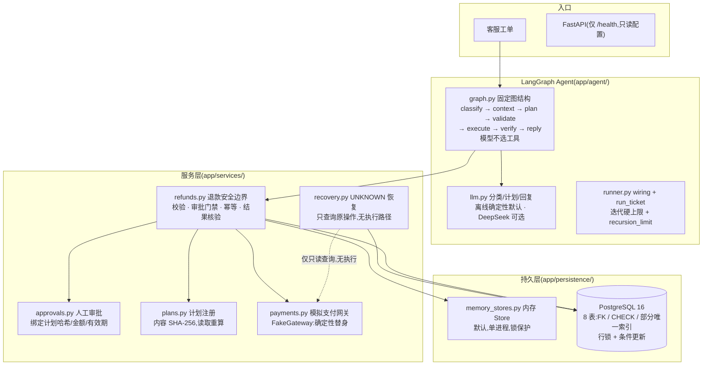
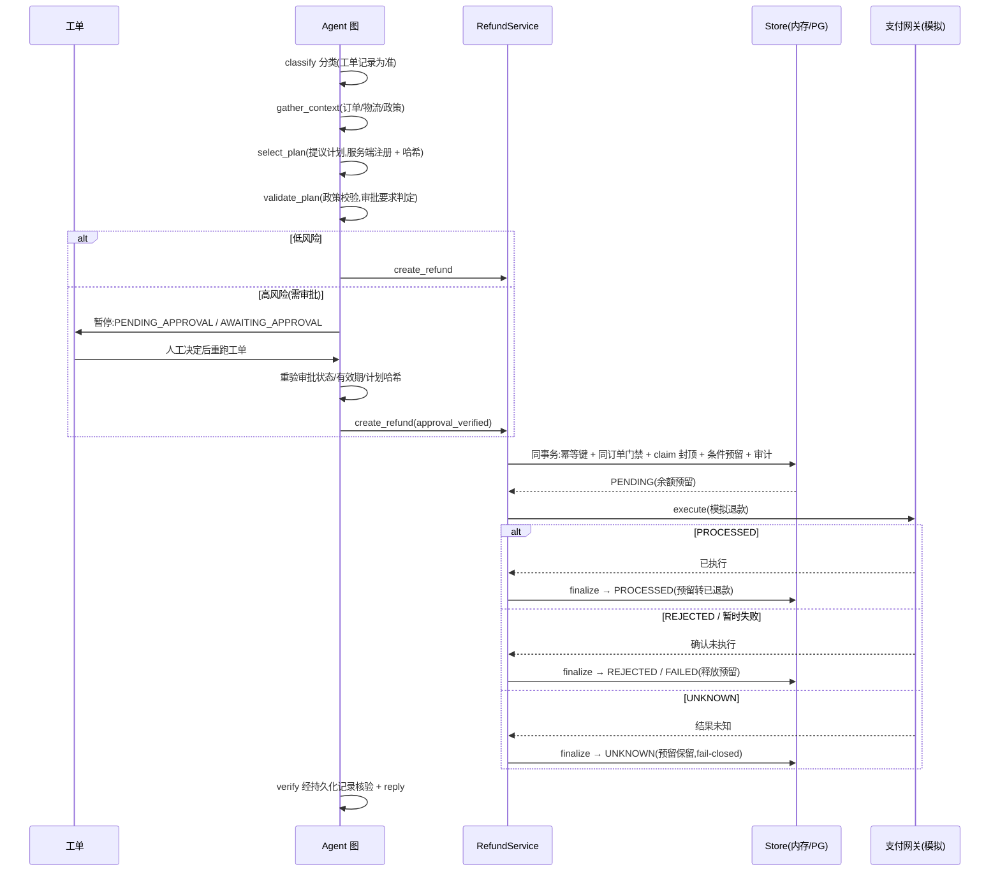
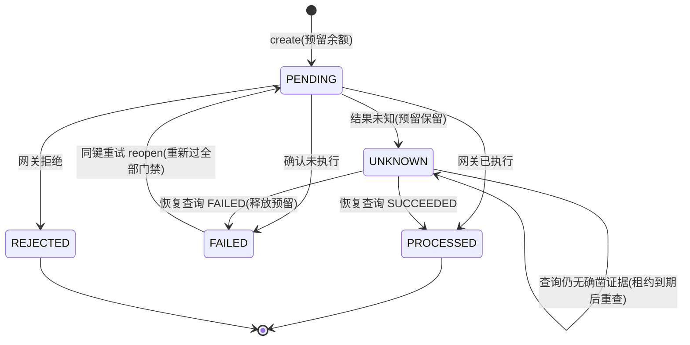
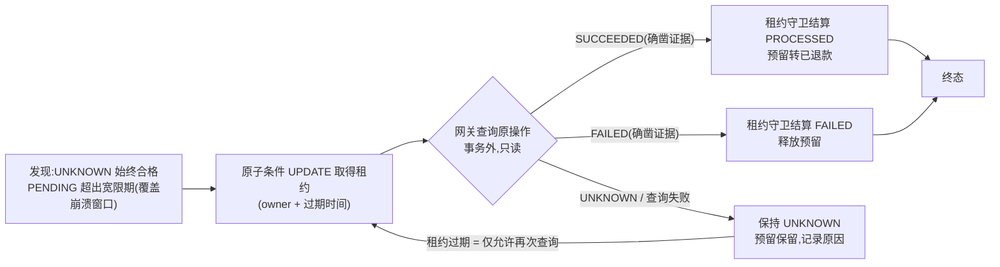

# SupportFlow

一个使用 LangGraph 编排客服退款流程的 Python Agent,结合 PostgreSQL 持久化、退款幂等控制、人工审批门禁和 UNKNOWN 结果恢复,演示「外部网关调用与本地数据库事务不构成原子事务」时如何安全处理故障。

> **项目状态**:教学/作品集项目。退款为模拟操作([FakeGateway](app/services/payments.py) 确定性替身),不连接真实支付网关;真实网关契约、幂等窗口与最终一致性尚未验证。本系统不是经过生产验证的支付系统,也不宣称绝对安全。

解决的问题:

- **LLM 不可信输入**:工单文本与模型提议一律视为不可信,订单归属、金额、政策、审批、执行权限全部由服务端确定性规则重验;
- **重复与并发**:同一请求重放、并发双跑、Agent 重试都不能产生第二笔退款或重复记账;
- **人工审批门禁**:高风险退款(如「物流已签收、客户称未收到」)必须经人工批准,审批绑定计划内容哈希,修改计划或伪造审批均无法放行;
- **结果不确定时的安全收敛**:网关超时/崩溃/查询失败绝不臆断——预留保留(fail-closed),由恢复服务只查询原操作,仅凭确凿证据结算或释放;
- **跨重启可审计**:PostgreSQL 后端下,退款、账务、审计、恢复租约全部落库,审计与业务变更同事务提交。

## 设计亮点

每条亮点按「问题 → 设计 → 代码位置 → 验证方式」说明。

### 1. 为什么退款需要预留额度(reservation)

- **问题**:退款从校验到网关确认之间有时间窗,期间并发请求或重试可能重复占用同一笔可退余额;若只记「已退款」不记「在途」,余额会在确认前被再次花掉。
- **设计**:创建退款时在**同一数据库事务**内原子预留——一条条件 UPDATE(`refunded + reserved + amount <= total`),而不是先读后写;网关确认后把预留转入已退款,失败/拒绝则释放,结果未知则保留(fail-closed)。库级 CHECK 约束兜底:任何路径都无法让 `refunded + reserved > total`。
- **代码**:[pg_refund_store.py](app/persistence/pg_refund_store.py) `_create_new` 条件 UPDATE + `_move_balances`;[models.py](app/persistence/models.py) `ck_orders_balance_invariant`。
- **验证**:`test_insufficient_balance_commits_nothing`(超额拒绝零账务变化)、`test_two_processes_two_orders_balance_invariants`(真实 PG 双进程并发,余额不变量保持)。

### 2. 如何避免重复退款与重复记账

- **问题**:网络重试、Agent 重跑、并发双跑都可能让同一个退款请求被执行两次——扣两次钱或记两次账。
- **设计**:全意图幂等键(工单+订单+金额+计划版本等绑定为一个键,数据库唯一约束);同键重放解析到原记录,异意图冲突明确拒绝;结算路径在行锁下重查状态,终态不可二次结算。
- **代码**:[pg_refund_store.py](app/persistence/pg_refund_store.py) `create` 同键分支、`finalize` 锁后状态复查;[models.py](app/persistence/models.py) `uq_refunds_idempotency_key`。
- **验证**:`test_same_key_same_intent_never_creates_a_second_row`、`test_finalize_never_settles_twice`、`test_two_processes_finalize_no_double_settle`(spawn 双进程,恰一次结算)。

### 3. 如何区分网关执行结果与本地数据库状态

- **问题**:网关异常(超时、连接中断)说明不了退款是否已执行——连接可能在钱已划走后断开。凭异常类型推断结果会误放预留或误报成功。
- **设计**:网关结果与本地状态显式分离:`GatewayOutcome`(网关侧:已执行/拒绝/确认未执行/未知)vs `RefundStatus`(本地账务:PENDING/UNKNOWN/终态)。异常一律按 UNKNOWN 处理,预留保留;只有显式的「确认未执行」才走失败释放路径。
- **代码**:[refunds.py](app/services/refunds.py) `_execute` 异常分支、`_apply_gateway_outcome` 结果分类。
- **验证**:`test_unknown_outcome_keeps_reservation_and_resolves_by_query`、`test_query_error_never_becomes_failed`(查询失败不误判)。

### 4. 为什么 UNKNOWN 不能直接视为失败

- **问题**:把 UNKNOWN 当成 FAILED 会释放预留,而网关可能已经把钱退给客户——结果是被退款且余额被他人再用,或重复退款。
- **设计**:UNKNOWN 保留状态与预留(fail-closed),同键重试时**查询原操作**(只读)再决定;恢复服务同样只凭确凿证据结算。终态行永不移动。
- **代码**:[recovery.py](app/services/recovery.py) `plan_recovery_action`;[refunds.py](app/services/refunds.py) `_resolve_unknown`。
- **验证**:`test_unknown_evidence_keeps_status_and_reservation`(预留保持 50.00)、`test_terminal_rows_are_never_moved_regardless_of_evidence`。

### 5. 如何用稳定操作标识查询原操作

- **问题**:恢复/重试必须问网关「那笔操作到底怎样了」,但拿什么问?若查询键不稳定(或每次重试生成新键),查询就落空。
- **设计**:`refund_id` 在**任何网关调用之前**随 PENDING 行落库(create 事务先于 execute),它就是网关查询键;恢复服务与同键重试都用它查询**原始操作**,绝不新建操作。
- **代码**:[pg_refund_store.py](app/persistence/pg_refund_store.py) `create`;[recovery.py](app/services/recovery.py) `_recover_one`。
- **验证**:`test_crash_window_pending_row_is_recovered`(崩溃窗口行被恢复,且 `gateway.execute_calls == 0`)。

### 6. 恢复 worker 如何用租约、owner token 和事务保护结算

- **问题**:多个恢复 worker 并发扫描同一批 UNKNOWN 退款时,可能重复查询、重复结算;崩溃的 worker 留下的状态还可能被迟到结果覆盖。
- **设计**:三段式——①原子条件 UPDATE 取得**租约**(owner token + 过期时间,`rowcount==1` 者得);②网关查询在**事务外**执行(不持锁等网络);③结算在新事务中 `FOR UPDATE` 重读行 + owner token 校验,租约过期或被接管则拒绝写入。租约过期只意味着允许再次查询,绝不意味着可以再次执行。
- **代码**:[pg_refund_store.py](app/persistence/pg_refund_store.py) `claim_recovery` / `settle_recovered`;[recovery.py](app/services/recovery.py) `_recover_one`。
- **验证**:`test_two_concurrent_workers_settle_exactly_once`、`test_stale_worker_cannot_overwrite_newer_state`、`test_crashed_worker_claim_recovers_after_lease_expiry`。

### 7. 如何通过审计记录追踪状态变化

- **问题**:出了问题时需要回答「谁在什么时候把哪笔钱怎么样了」——没有审计,只有终态。
- **设计**:每次状态变化(创建/结算/释放/恢复/审批)与业务变更**同事务**写入审计事件(actor/action/关联 ID/明细);审计写失败则整体回滚——审计里永远不会出现数据库里不存在的状态。
- **代码**:[pg_refund_store.py](app/persistence/pg_refund_store.py) 各路径 `_audit_row`;[models.py](app/persistence/models.py) `audit_events` 表。
- **验证**:`test_recovery_settle_writes_audit_and_failure_rolls_back_atomically`(故障注入:审计抛错 → 状态/余额/审计整体回滚,孤儿审计=0)。

## 架构

技术栈:Python 3.12+ · uv · LangGraph · SQLAlchemy 2.x(Alembic 迁移)· Pydantic v2 · FastAPI · PostgreSQL 16 · pytest。运行时后端可切换:内存 Store(默认,单进程演示)与 PostgreSQL(退款链路全落库)。



### 正常退款流程



### 退款状态机与 UNKNOWN 恢复



恢复闭环([recovery.py](app/services/recovery.py),结构上**没有执行路径**——恢复侧只调用只读的 `query_status`,从构造上杜绝二次扣款):



### 关键安全不变量

| # | 不变量 | 实现位置 |
| --- | --- | --- |
| 1 | 幂等:同请求重放/跨进程重试解析到同一退款,绝不建第二行 | 全意图幂等键 + DB 唯一约束 `uq_refunds_idempotency_key`([models.py](app/persistence/models.py)) |
| 2 | 同订单至多一笔 PENDING\|UNKNOWN 退款 | 部分唯一索引 `uq_refunds_order_unresolved` + 应用层同订单门禁 |
| 3 | 余额:预留是条件 UPDATE(非读后写),库级 CHECK 兜底 | [pg_refund_store.py](app/persistence/pg_refund_store.py) 条件 UPDATE;`ck_orders_balance_invariant` |
| 4 | 工单索赔封顶读自**锁定**的工单行,不信任调用方参数 | `FOR UPDATE` + 聚合计算([pg_refund_store.py](app/persistence/pg_refund_store.py)) |
| 5 | 审计与业务变更同事务:审计写失败则退款整体回滚 | 所有 store 路径同一事务写审计;集成测试含原子性故障注入 |
| 6 | 行锁顺序固定 orders → tickets → refunds,无反向加锁路径 | 各 store 方法 |
| 7 | 唯一冲突按约束名精确映射,其余 DB 错误原样抛出,不伪装成业务拒绝 | `_constraint_name` 白名单 |
| 8 | 审批绑定计划内容哈希;执行前重新加载并复核哈希/金额/有效期 | [plans.py](app/services/plans.py) + [approvals.py](app/services/approvals.py) |
| 9 | 终态(PROCESSED/REJECTED)永不移动;UNKNOWN 绝不自动当成 FAILED | `plan_recovery_action` + 结算前状态复查 |
| 10 | 恢复只查询、无执行;租约过期只允许再次查询,绝不代表可再次执行 | [recovery.py](app/services/recovery.py) 无 execute 路径(测试断言 `execute_calls == 0`) |
| 11 | 数据库事务绝不跨网关调用 | claim(事务)→ 查询(事务外)→ 结算(新事务,行锁 + owner 校验) |
| 12 | Agent 循环硬上限 + LangGraph recursion_limit;运行记录库级 CHECK `iterations <= max_iterations` | [runner.py](app/agent/runner.py) + [models.py](app/persistence/models.py) |
| 13 | 后端显式选择:PG 初始化失败即抛错,绝不静默回退内存 | [runner.py](app/agent/runner.py) `build_agent_wiring` |

## 快速开始

```bash
uv sync                # 前置:Python >= 3.12 与 uv;锁文件 uv.lock 保证依赖可复现
cp .env.example .env   # .env.example 只含占位符,不配置 API Key 也能完整离线运行
```

**内存模式端到端演示**。前置:仅上面两步,无需数据库、网络或 LLM Key;确定性输出:

```bash
uv run python -m app.agent.demo
```

**HTTP API**(当前仅健康检查)。前置:同上,无需数据库(`/health` 只读配置,不连库):

```bash
uv run uvicorn app.api.app:create_app --factory --port 8000
curl http://127.0.0.1:8000/health
# → {"status":"ok","app_env":"development","llm_configured":"false"}
```

**PostgreSQL 模式**(可选)。前置:本地 Docker 可用;PG 仅监听回环端口,密码在 `.env` 的 `POSTGRES_PASSWORD` 中,由 compose 注入——示例中的 `<密码>` 是占位符,请勿把真实密码写进任何可复制粘贴的文档:

```bash
docker compose up -d --wait       # postgres:16-alpine @ 127.0.0.1:5432,等待健康检查
uv run alembic upgrade head       # 迁移 0001 → 0003,幂等
SUPPORTFLOW_STORE_BACKEND=postgres \
SUPPORTFLOW_DATABASE_URL=postgresql+psycopg://supportflow:<密码>@127.0.0.1:5432/supportflow \
  uv run python -m app.agent.demo
```

配置项(环境变量,前缀 `SUPPORTFLOW_`,API Key 仅经环境变量注入,日志层对 secret 字段统一脱敏):

| 变量 | 默认值 | 说明 |
| --- | --- | --- |
| `SUPPORTFLOW_APP_ENV` | `development` | development / test / production |
| `SUPPORTFLOW_DEEPSEEK_API_KEY`(或 `DEEPSEEK_API_KEY`) | 空 | DeepSeek API Key;缺失时用确定性离线实现 |
| `SUPPORTFLOW_DATABASE_URL` | `sqlite:///supportflow.db` | `SUPPORTFLOW_STORE_BACKEND=postgres` 时必须为 `postgresql+psycopg://` |
| `SUPPORTFLOW_STORE_BACKEND` | `memory` | `memory`(单进程)或 `postgres`(退款链路全落库) |
| `SUPPORTFLOW_TEST_DATABASE_URL` | 空 | PG 集成测试专用库(库名须以 `_test` 结尾);未设置时集成测试跳过 |
| `SUPPORTFLOW_MAX_AGENT_ITERATIONS` | `10` | Agent 循环硬上限 |
| `SUPPORTFLOW_TOOL_TIMEOUT_SECONDS` | `30` | 单次工具调用超时 |

## Demo 与预期输出

### Agent 演示(内存模式,4 场景)

`uv run python -m app.agent.demo` 的实际输出(`REF-`/`RUN-`/`PLAN-` 后为随机 id,每次不同):

```
refundable (low-risk refund)         phase=completed          run=completed          plan=PLAN-… iterations=1
    reply: Refund of 199.99 USD for order ORD-1001 has been processed. Refund reference: REF-…
delivered_not_received (first run)   phase=pending_approval   run=awaiting_approval  plan=PLAN-… iterations=0
delivered_not_received (after APPROVED) phase=completed          run=completed          plan=PLAN-… iterations=1
    reply: Refund of 129.90 USD for order ORD-1005 has been processed. Refund reference: REF-…
amount_mismatch (claim > total)      phase=completed          run=completed          plan=-                 iterations=0
    reply: We could not process this request: the claim exceeds the order total. …
non_existent (order missing)         phase=completed          run=completed          plan=-                 iterations=0
    reply: We could not process this request: order ORD-9999 not found. …
```

四个场景依次验证:低风险自动退款 → 高风险暂停等待审批、人工批准后恢复执行 → 索赔超额拒绝 → 订单不存在拒绝。之后打印完整审计轨迹(每次工具调用一行,含 outcome/ticket/run)。PG 模式第二遍运行时,已退款订单被余额门禁拒绝,账务不变(演示持久化)。

### 崩溃恢复演示(PG 模式,两进程两阶段)

模拟「网关已执行退款、应用在 finalize 前崩溃」的窗口:

```bash
docker compose exec postgres createdb -U supportflow supportflow_demo   # 一次性演示库,可 drop 重来
SUPPORTFLOW_STORE_BACKEND=postgres \
SUPPORTFLOW_DATABASE_URL=postgresql+psycopg://supportflow:<密码>@127.0.0.1:5432/supportflow_demo \
  uv run alembic upgrade head
SUPPORTFLOW_STORE_BACKEND=postgres \
SUPPORTFLOW_DATABASE_URL=postgresql+psycopg://supportflow:<密码>@127.0.0.1:5432/supportflow_demo \
  uv run python -m app.recovery_demo --phase crash
SUPPORTFLOW_STORE_BACKEND=postgres \
SUPPORTFLOW_DATABASE_URL=postgresql+psycopg://supportflow:<密码>@127.0.0.1:5432/supportflow_demo \
  uv run python -m app.recovery_demo --phase recover
```

阶段 1(`--phase crash`)实际输出:创建退款行(PENDING、预留 50.00),替身网关记账成功,进程在 finalize 前退出;网关状态经 JSON 账本文件跨「崩溃」存活。

```
phase crash: refund REF-… created (PENDING, reserved 50.00)
  gateway executed successfully; application crashed before finalize
  gateway ledger written to demo_gateway_ledger.json
```

阶段 2(`--phase recover`,新进程)实际输出:恢复服务发现该行、查询原操作、凭证据结算;第二次运行发现 0 行,金额不再移动。

```
recovery run 1: discovered=1 settled_processed=1 settled_failed=0 kept_unknown=0
  REF-…: settled_processed (gateway succeeded)
  after recovery: status=processed refunded=50.00 reserved=0.00
recovery run 2: discovered=0 settled_processed=0 kept_unknown=0
  after second run: status=processed refunded=50.00 reserved=0.00
```

## 测试

```bash
uv run pytest          # 单元/图测试:262 个,不依赖网络与真实 LLM
```

PG 集成测试(51 个)需要本地 PostgreSQL 与专用测试库:

```bash
docker compose up -d --wait
docker compose exec postgres createdb -U supportflow supportflow_test
SUPPORTFLOW_TEST_DATABASE_URL=postgresql+psycopg://supportflow:<密码>@127.0.0.1:5432/supportflow_test \
  uv run pytest tests/integration -q
```

设计约定:测试不依赖真实 LLM、真实退款或网络;未设置 `SUPPORTFLOW_TEST_DATABASE_URL` 时集成测试跳过,库名不以 `_test` 结尾时直接失败(防止误连开发库)。

### 实际测试结果(2026-10-11 实测)

| 套件 | 命令 | 结果 |
| --- | --- | --- |
| 单元/图测试 | `uv run pytest` | **262 passed**;51 个集成测试因未设置 PG 测试库而 skipped(设计行为) |
| PG 集成测试 | 设置 `SUPPORTFLOW_TEST_DATABASE_URL` 后 `uv run pytest tests/integration -q` | **51 passed**(真实 PostgreSQL 16;含 `multiprocessing` spawn 双进程竞态、约束直测、恢复闭环、审计原子性故障注入) |
| 8 条业务路径抽查 | 指定 12 个测试 id 重跑 | **12 passed**(正常退款、超额拒绝、幂等重放、审批两阶段、UNKNOWN 收敛、崩溃窗口恢复、双 worker 恰一次、重启后状态重建) |
| API smoke test | `uvicorn app.api.app:create_app --factory` + `GET /health` | 200,`{"status":"ok",…}` |
| Agent demo / 恢复 demo | 见上文两节 | 输出与预期一致;恢复 demo 二跑金额不变 |

## 已知限制与未验证项(如实说明)

- **退款为模拟操作**。[FakeGateway](app/services/payments.py) 是带账本的确定性替身,仅用于开发、测试与演示,**不是真实支付网关**;真实网关的状态查询契约(SUCCEEDED/FAILED/UNKNOWN 三分类的准确性)、幂等窗口、最终一致性尚未验证(当前无网关凭证/测试环境)。
- **执行侧崩溃窗口**。恢复服务保证「不盲目二次执行」,但若真实网关自身无幂等键支持,`create`(落库)与 `execute`(网关)之间崩溃后的重试语义取决于原执行路径与网关契约——数据库事务与外部网关调用不构成原子事务,本项目对此不做虚假承诺。
- **内存后端是默认**,单进程、不可跨重启恢复;跨重启的恢复闭环只在 PostgreSQL 后端存在。
- **DeepSeek 路径未经真实调用测试**(无 API Key);所有断言基于离线确定性协作者。
- PG 模式下工单状态流转、审批记录、工单备注仍为内存会话状态(重启丢失);丢失后果 fail-closed:执行前必须重新走完整审批门禁。
- 长期 UNKNOWN 的退款会按租约周期反复查询(每次一个只读查询),无自动告警或死信机制;运营侧需自行监控 `last_recovery_error`。
- 无分布式调度:恢复需外部触发(定时调用 `RecoveryService.recover_once()`,如 cron)。
- HTTP API 目前仅 `/health`,无退款业务端点。
- 环境步骤未在全新机器验证:uv 的安装、Docker 的安装与镜像拉取在本机环境已具备,未在全新机器上从头走通;除此之外的步骤(依赖同步、迁移、测试、demo)均已实机执行。

## 项目结构

```
app/
├── config.py            # Settings(env 前缀 SUPPORTFLOW_,secret 脱敏)
├── logging_config.py    # 结构化 JSON 日志 + 密钥脱敏
├── api/app.py           # FastAPI 工厂(create_app,/health)
├── agent/
│   ├── state.py         # AgentState 与阶段常量
│   ├── graph.py         # LangGraph 图:节点、条件路由、有界循环
│   ├── llm.py           # 分类/计划/回复接口 + 离线默认 + DeepSeek 实现
│   ├── runner.py        # build_agent_wiring / run_ticket(迭代硬上限)
│   └── demo.py          # 确定性端到端演示(4 场景,离线)
├── recovery_demo.py     # 崩溃恢复两阶段演示(--phase crash|recover,仅 PG)
├── domain/              # 枚举、金额规则(Decimal)、Pydantic 模型
├── persistence/
│   ├── memory_stores.py     # 内存 Store:锁保护原子操作(默认运行时)
│   ├── refund_store.py      # RefundStoreProtocol + 创建结果类型
│   ├── models.py            # 8 表 ORM 模型(FK/CHECK/部分唯一索引)
│   ├── pg_refund_store.py   # PG 退款存储:行锁 + 条件更新 + 审计同事务 + 恢复租约
│   ├── db.py                # engine/session 工厂(方言选择,失败不静默回退)
│   ├── pg_stores.py         # PG 订单/计划/审计/运行存储
│   ├── pg_catalog.py        # PG catalog 幂等 seed(ON CONFLICT DO NOTHING)
│   └── mock_catalog.py      # 6 个确定性模拟场景
├── services/
│   ├── refund_policy.py # 结构化退款政策(纯函数,默认拒绝)
│   ├── payments.py      # 模拟支付网关 + 查询协议 + FakeGateway 替身
│   ├── refunds.py       # 退款安全边界:校验、审批门禁、幂等、结果核验
│   ├── plans.py         # PlanStore:内容哈希、同 id 异内容拒绝、读取重算
│   ├── approvals.py     # ApprovalService:请求去重、decide(人工侧入口)
│   ├── recovery.py      # UNKNOWN 恢复:租约、只读查询、租约守卫结算
│   └── audit.py         # 审计事件记录器
└── tools/
    ├── result.py        # ToolResult 统一结果信封
    ├── context.py       # ToolContext(工单/运行上下文)
    ├── schemas.py       # 工具输入模型(Pydantic 校验)
    ├── audit.py         # audited 装饰器(审计 + 异常收敛)
    └── registry.py      # ToolSet + build_default_tool_set(唯一注册入口)
tests/
├── test_agent_day3.py   # 图行为场景 + 静态守卫(断言状态而非文本)
├── test_p1_fixes.py     # P1 加固回归:审批 fail-closed、索赔封顶
├── test_review2_fixes.py# 复审回归:同键重试重查额度、审批排序、计划漂移
├── test_recovery_unit.py# 恢复决策/网关映射/服务流控单测(不连库)
├── integration/         # PG 集成测试 51 个:双进程竞态、全链路、约束、恢复闭环
└── test_*.py            # Day 1-2 领域/工具/审计测试
migrations/              # Alembic:0001(8 表)→ 0002(加宽 status)→ 0003(恢复租约字段)
compose.yaml             # 本地开发 PostgreSQL(postgres:16-alpine,仅回环)
```

## 开发历史(压缩)

- **Day 1**:领域模型与枚举、金额规则(Decimal)、统一 ToolResult、配置(SecretStr)、结构化日志(脱敏)、6 个确定性模拟场景。
- **Day 2**:5 个业务工具(订单/物流/政策/退款/备注);退款服务端全量校验,不信任 LLM;模拟网关三类非成功结果(REJECTED / 确认未执行 / UNKNOWN),UNKNOWN 保留预留且必须先查原操作;审计每次工具调用。
- **Day 3**:LangGraph 固定图(模型不选工具);LLM 只提计划提议,服务端注册计划(内容 SHA-256)并绑定审批;高风险暂停 → 人工决定 → 重跑时复用审批绑定计划并重验(状态/有效期/哈希);执行后经持久化记录核验;工单级索赔封顶。
- **Day 4**:PostgreSQL 8 表 ORM + Alembic 迁移(显式命名全部约束);PgRefundStore 与内存版语义逐条对齐;22 个集成测试实机通过;实机验收发现并修复 2 个并发缺陷(锁后陈旧读、锁后幂等键重查)。
- **Day 5**:PG 全链路接线(Agent→services→tools 同一 Store 依赖);后端显式选择、无静默回退;38 个集成测试(含双进程竞态、审计原子性、约束直测)。
- **Day 6**:UNKNOWN 恢复闭环——三类查询协议、租约(原子条件 UPDATE)、只查询无执行的恢复服务、崩溃窗口覆盖;4 个恢复字段迁移(0003);两进程崩溃恢复演示;262 单测 + 51 集成。
- **Day 7**(本次):作品集交付——8 条业务路径实机取证、安全不变量源码级审查、干净环境启动路径核对、本 README 重构(架构图/流程图/状态机/不变量/实测结果)、安全与交付检查。
